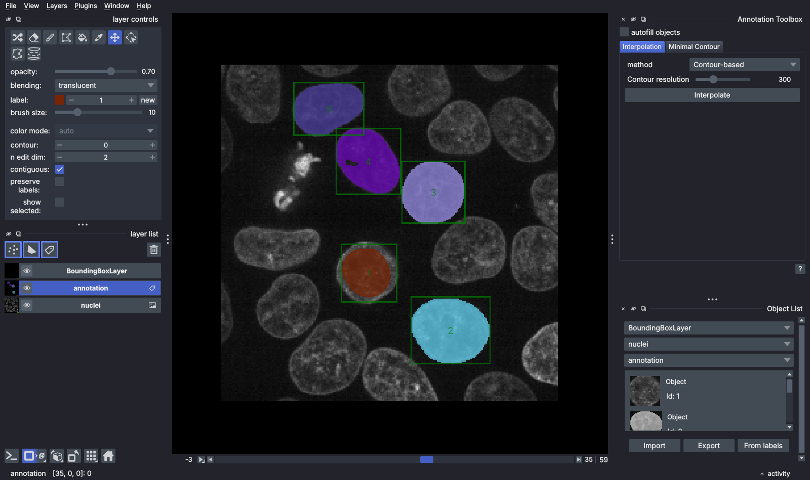
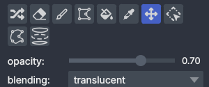
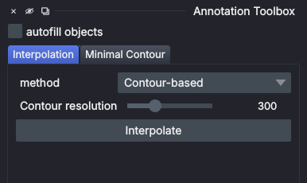
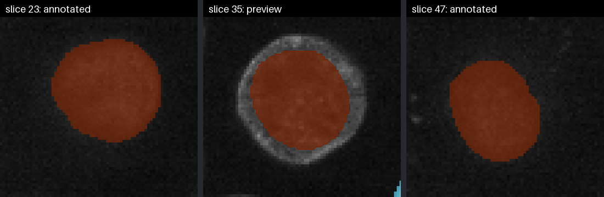
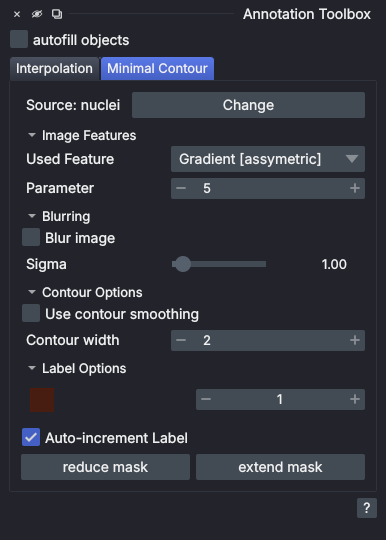
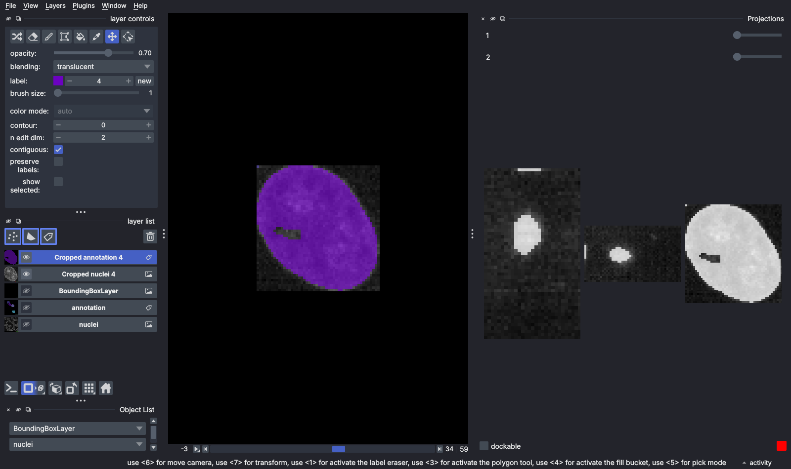

# napari-nD-annotator

[](https://github.com/bauerdavid/napari-nD-annotator/raw/main/LICENSE)
[](https://pypi.org/project/napari-nD-annotator)
[](https://anaconda.org/conda-forge/napari-nd-annotator)
[](https://python.org)
[](https://github.com/bauerdavid/napari-nD-annotator/actions)
[](https://codecov.io/gh/bauerdavid/napari-nD-annotator)
[](https://napari-hub.org/plugins/napari-nD-annotator)
[](https://pepy.tech/projects/napari-nd-annotator)

**A toolbox for annotating objects one by one in nD.**

This [napari] plugin makes 2D/3D (and technically any dimensional) annotation faster:

 * **Auto-filling labels**: draw the outline of an object and it is filled when you release the mouse
 * **Slice interpolation with live preview**: annotate a few slices and see the missing ones
   estimated on the fly (contour-based, distance-based or RPSV interpolation)
 * **Minimal contour**: a drawing mode for labels layers in which the contour snaps to
   image edges or intensities between the points you click
 * **Object list** (with <code>[napari-bbox]</code>): list objects marked with bounding boxes,
   crop them one by one and check them in orthogonal projections
 * **Minimal surface** (experimental, with <code>[minimal-surface]</code>): estimate the surface of a 3D object
   from a few point pairs



## Installation

You can install `napari-nD-annotator` via [pip]:

    pip install napari-nD-annotator

or from [conda-forge]:

    conda install -c conda-forge napari-nd-annotator

The plugin is also available on [napari-hub]. To install it directly from napari, see the
[plugin installation instructions] on the official [napari] website.

Prebuilt wheels are available for Windows, Linux and macOS (Intel and Apple Silicon), for
Python 3.9 to 3.14. The plugin requires `napari>=0.5.0`.

### Optional packages
Some features need additional Python packages.

#### Bounding boxes
The object list and bounding box features require the <code>[napari-bbox]</code> package.
Install it separately (with [pip] or from napari), or together with this plugin:
```
pip install napari-nD-annotator[bbox]
```

#### Minimal surface
The minimal surface method requires the <code>[minimal-surface]</code> package:
```
pip install napari-nD-annotator[ms]
```

> [!WARNING]
> <code>[minimal-surface]</code> is currently available **for Windows only**. Linux and macOS support
> is in progress. Until then, `pip install napari-nD-annotator[ms]` and `pip install napari-nD-annotator[all]`
> fail on Linux and macOS; use `pip install napari-nD-annotator[bbox]` there instead.

To install all optional packages (Windows only for now), use
```
pip install napari-nD-annotator[all]
```

If any problems occur during installation or while using the plugin, please [file an issue].

## Getting started
Start napari with the plugin's widgets already open:

    napari -w napari-nD-annotator "Annotation Toolbox" "Object List"

You can also open them from the `Plugins` menu. The interpolation tools are also available on their own
as the `Slice Interpolator` widget.

A typical session:

 1. Open an image and add a labels layer of the same shape (`Layers > New Labels Layer`).
 2. Select the labels layer. The first time you do this, the plugin asks which image layer is the
    **source image** of these labels (see [Source image](#source-image)).
 3. Annotate with napari's paint brush, the minimal contour tool, or both, and fill in the missing slices with
    [slice interpolation](#slice-interpolation).

## Annotation Toolbox
The `Annotation Toolbox` widget has an **autofill objects** checkbox and a tab for each tool:
`Interpolation`, `Minimal Contour` and, when <code>[minimal-surface]</code> is installed, `Minimal Surface`.
The `?` button in the bottom right corner lists the keyboard shortcuts.
Widget settings are saved and restored the next time you open napari.

The plugin also adds two buttons to the controls of the active labels layer, below napari's own tools:



 * **Minimal contour** (left, shortcut `0`): switches to the minimal contour drawing mode
 * **Interpolate** (right, shortcut `I`): writes the interpolated slices into the labels layer

### Autofill objects
When **autofill objects** is checked and the labels layer is in paint mode, the outline you draw is
closed and filled when you release the mouse button. You only have to trace the border of an
object instead of painting its whole area.

> 🎬 **GIF placeholder: `docs/images/autofill.gif`**
> Paint mode with autofill on: trace the outline of a nucleus, release the mouse, the area fills.
> Draw a second object with autofill off for comparison.

## Slice interpolation


Annotate an object on a few slices along one axis, and the plugin estimates the slices in between.
The estimated contours appear as a **live preview** on the empty slices. They update as you paint and
when you change the selected label, the method or the viewed axis. Nothing is written to the labels
layer until you click **Interpolate** (in the tab or in the layer controls) or press `I`.
Painting on a slice that shows a preview also fills in the previewed object on that slice.



Interpolation works on 3D labels layers viewed in 2D, and is computed for the currently selected label.

Settings:
 * **method**
   * *Contour-based*: interpolates between corresponding points of the contours on the two annotated slices
   * *Distance-based*: interpolates between the signed distance maps of the annotations
   * *RPSV*: shape-aware averaging of contours, see the [preprint](https://arxiv.org/pdf/1901.02823.pdf).
     **RPSV max iterations** limits how many iterations it may use.
 * **Contour resolution**: number of points sampled along each contour (Contour-based and RPSV only)

> **Note**: Contour-based and RPSV interpolation use one connected mask per slice (the largest one).
> If you want to interpolate disjoint objects (*e.g.* dividing cells), use distance-based interpolation instead.

> **Note**: Distance-based interpolation might give bad results if some masks are too far away from each other on the same slice
> and there's a big offset compared to the other slice used in the interpolation. If you get unsatisfactory results, try
> annotating more slices (skip fewer frames).

> 🎬 **GIF placeholder: `docs/images/interpolation.gif`**
> Annotate a nucleus on two slices far apart. Scroll through the slices between them to show the
> preview outlines. Paint over one previewed slice, then press `I` and scroll again to show the filled
> result. Optionally switch the method to show the preview updating.

## Minimal contour
The minimal contour tool draws a contour through the points you click. Between two points, the contour
follows the lowest-cost path on an image feature, such as edges or high/low intensity pixels.



### Source image
Each labels layer is linked to the image layer it annotates. When you select a labels layer that has no
source image yet, a dialog asks you to pick one. If the shapes differ, the plugin offers to resize the
labels layer (this clears its content). The current source is shown at the top of the `Minimal Contour` tab;
click **Change** to pick another one.

### Drawing a contour
Select the labels layer and click the minimal contour button in the layer controls, or press `0`. Then:

 * **Click** to add a point. The contour from the last point to the cursor is previewed.
 * **Double-click** to close the contour. The enclosed area is filled with the selected label.
 * Hold `Ctrl` to add a straight line segment instead of the minimal path.
 * Press `Esc` to discard the points placed so far.

### Settings
 * **Image Features**
   * **Used Feature**: what the contour should follow: *Gradient [assymetric]*, *Gradient [symmetric]*,
     *High intensity*, *Low intensity* or *Custom*
   * **Parameter** (asymmetric gradient only): how strongly the contour follows the image. Higher values
     follow edges more closely; lower values give paths closer to straight lines.
   * *Custom* opens a small Python editor. The current slice of the source image is available as the
     `image` variable; store your feature map (2D, or 2D with 3 channels) in the `features` variable and
     click `Run`.
 * **Blurring**: blur the image (Gaussian, with the given **Sigma**) before computing the features
 * **Contour Options**
   * **Use contour smoothing** / **Contour smoothness**: smooth the finished contour with a Fourier
     approximation. Lower values give smoother contours.
   * **Contour width**: line width of the contour preview
 * **Label Options**
   * the selected label and its color
   * **Auto-increment Label**: move to the next label after each completed contour
   * **reduce mask** / **extend mask**: shrink or grow the selected label by one pixel (`Ctrl+-` / `Ctrl++`)

> 🎬 **GIF placeholder: `docs/images/minimal_contour.gif`**
> Activate the minimal contour mode with the layer-control button. Click a few points around a nucleus with
> *Gradient [assymetric]*, hold `Ctrl` for one straight segment, double-click to close and show the fill and
> the auto-incremented label. Press `Esc` once on a half-drawn contour.

> 🎬 **GIF placeholder: `docs/images/minimal_contour_features.gif`**
> The same object drawn with *High intensity* and with *Gradient [assymetric]* at two **Parameter** values,
> optionally with blurring on, to show how the feature changes the path.

> 🎬 **GIF placeholder: `docs/images/minimal_contour_custom.gif`**
> Select *Custom*, type a short script (*e.g.* `from skimage.filters import sobel; features = sobel(image)`),
> click `Run`, then draw a contour.

## Minimal surface (experimental)
The `Minimal Surface` tab estimates the surface of a 3D object from pairs of points placed on its
boundary. A slice of the object is annotated (manually, by thresholding or with the minimal contour tool)
and the surface is computed between the point pairs.

The tab appears only when the <code>[minimal-surface]</code> package is installed, which is currently
Windows-only (see [Minimal surface installation](#minimal-surface)). This feature is under active development;
a detailed description will follow in a later release.

> **Warning**: The tab adds a `3D Anchors [DO NOT REMOVE]` points layer. Do not remove it while the widget is open.

## Object list and bounding boxes
With <code>[napari-bbox]</code> installed, the `Object List` widget lets you annotate objects one at a time.
Each object is marked with a bounding box and cropped when selected. This has two advantages, especially in 3D:

1. You don't have to load the whole data into memory.
2. Surrounding objects don't hide the annotated one, so it is easier to check the annotation.

Pick the bounding box, image and labels layers at the top of the widget. If there is no bounding box layer
yet, click **Create Bounding Box layer**, or **From labels** to create one box around every existing label.
**Import** and **Export** load and save bounding boxes as text files.
Each listed object shows a thumbnail, a name and its label ID.

Selecting an object hides the full layers, adds cropped copies of the image and labels, and opens a
`Projections` widget with orthogonal views of the crop:



The proposed pipeline:

 1. Create a bounding box layer
 2. Draw bounding boxes around the objects
 3. Select an object from the object list
 4. Annotate the object
 5. Repeat from 3.

> 🎬 **GIF placeholder: `docs/images/object_list.gif`**
> Draw a bounding box around a nucleus, show the new list entry with its thumbnail, select it, annotate a
> slice in the cropped layer, then select another object.

## Shortcuts

| Action                                        | Mouse               | Keyboard            |
|-----------------------------------------------|---------------------|---------------------|
| Increment selected label                      | `Shift + Wheel ⬆️`  | `E`                 |
| Decrement selected label                      | `Shift + Wheel ⬇️`  | `Q`                 |
| Previous slice                                | `Ctrl + Wheel ⬆️`\* | `A`                 |
| Next slice                                    | `Ctrl + Wheel ⬇️`\* | `D`                 |
| Increase paint brush size of labels layer     | `Alt + Wheel ⬆️`    | `W`                 |
| Decrease paint brush size of labels layer     | `Alt + Wheel ⬇️`    | `S`                 |
| Grow / shrink the selected label by one pixel | -                   | `Ctrl++` / `Ctrl+-` |
| Interpolate                                   | -                   | `I`                 |
| Switch to minimal contour mode                | -                   | `0`                 |
| Straight line segment (minimal contour)       | -                   | hold `Ctrl`         |
| Discard minimal contour points                | -                   | `Esc`               |
| Jump to layer `#i`                            | -                   | `Ctrl+i`\*\*        |

> *Built-in functionality of [napari]
>
> **`i`: 1-9

## License

Distributed under the terms of the [BSD-3] license,
"napari-nD-annotator" is free and open source software

## Issues

If you encounter any problems, please [file an issue] along with a detailed description.

[napari]: https://github.com/napari/napari
[napari-hub]: https://napari-hub.org/
[conda-forge]: https://anaconda.org/conda-forge/napari-nd-annotator
[BSD-3]: http://opensource.org/licenses/BSD-3-Clause
[pip]: https://pypi.org/project/pip/
[plugin installation instructions]: https://napari.org/stable/plugins/start_using_plugins/finding_and_installing_plugins.html
[file an issue]: https://github.com/bauerdavid/napari-nD-annotator/issues/new/choose
[napari-bbox]: https://github.com/bauerdavid/napari-bbox
[minimal-surface]: https://pypi.org/project/minimal-surface
